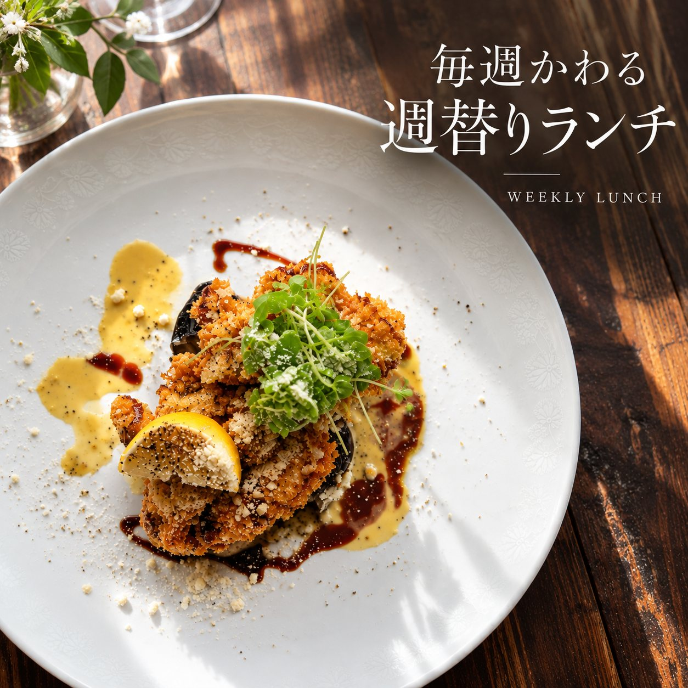

title: 二次会のお料理選び。大皿を囲むと、会話がはずむわけ
date: 2026-10-22
photo: drive2.jpg
---
二次会のお料理を決めるとき、「一人ずつのコース」にするか、「みんなで取り分ける大皿」にするかは、意外と迷うところです。今日は、大皿のお料理が、二次会の雰囲気をどう変えるかを考えてみました。

## 1. 大皿は、席を立つきっかけになる
一人ずつ盛り付けたお料理は、自分の席で食べ進めるので、会話は、どうしても隣の人と、向かいの人が中心になります。大皿なら、取り分けるために、自然と手が伸びて、席の近くの人とも言葉を交わします。新郎新婦の友人どうしが初めて会う二次会では、この「きっかけ」が、場をなごませてくれます。

## 2. 彩りがあると、写真にもきれいに残る
二次会では、料理の写真を撮るゲストも多いものです。写真のように、生ハムやオリーブ、食用花などで彩られた大皿が、テーブルの中央に並ぶと、それだけで、パーティーらしい華やかさが出ます。テーブルの上の風景を、記念として残しやすいのも、大皿のよいところです。

## 3. 幹事さんが、事前に確認しておきたいこと
大皿のお料理を選ぶときは、次のことを、事前に確認しておくと安心です。
- 苦手な食材やアレルギーのあるゲストがいないか。出欠をとるときに、一緒に聞いておくと、お店にも伝えやすくなります。
- 立食にするか、着席にするか。立食なら、取り分けやすいお料理が向いています。
- 人数に合った量と品数。迷ったら、お店に相談するのが確実です。

## 毎週かわる、POOLの週替りランチ

CAFE & RESTAURANT POOLでは、ランチに、毎週かわる「週替りランチ」を用意しています。写真は、レモンと青い芽を添えた、香ばしい一皿です。ランチの時間は11:30〜15:00（L.O.14:30）で、定休日は火曜日と第2水曜日です。時短営業や臨時休業がありますので、お出かけの前に、最新の情報をご確認ください。

## POOLでの二次会のお料理
二次会プランは、前菜から〆のパスタ、デザートまで全7品に、2時間の飲み放題が付いて、お一人様6,000円（税込）です。一軒家を貸し切る、20名様から、立食なら60名様までのパーティーに対応しています。お料理の内容や、大皿でのご用意は、ご人数やご予算に合わせて、ご相談ください。

お料理を囲んで、自然と会話がはずむ二次会に。奈良での貸切パーティーをお考えの方は、お気軽にご相談ください。
